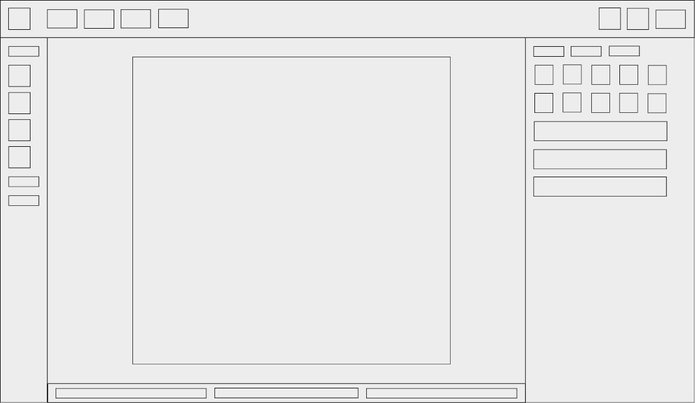

# Документация editorBlock

`editorBlock` - редактор HTML-блоков, предназначенный для создания и редактирования MD, CSS и JS-кода через веб-интерфейс.

## Структура внешнего вида

### Верхняя панель
- Меню действий с файлами - управление файлами (сохранение, открытие итд.)
- Вкладки блоков - переключение между открытыми блоками
- Кнопки назад / вперёд - история изменений
- Кнопка предпросмотра - запуск режима просмотра блока

### Левая панель
- Кнопки вставки элементов (разбитые по вкладкам) - добавление HTML-элементов в блок

### Центральная панель
- Основной блок просмотра визуального режима, MD-кода или JS-кода
- Кнопки переключения режимов (визуальный / MD / JS)

### Правая панель
- Сверху вкладки для переключения разделов:
- Свойства текста - параметры текста (цвет, размер итд.)
- Свойства элемента - свойства стиля и атрибуты выбранного элемента
- Редактор событий - обработчики JS событий элемента и назначение функций

## Файлы

- JS-файл загрузки `editorBlock` - точка входа редактора, инициализация всех модулей
- Папка с блоками - содержит блоки редактора

## Блоки

Блок - папка, представляющая отдельный модуль редактора, содержит `content.md`, `style.css` и `script.js`.

### Основа редактора
- `mainBlock` - основной каркас редактора и базовые стили/логика
    - общая структура интерфейса редактора
    - базовые стили интерфейса и элементов
    - синхронизация между `viewBlock` и `blocksContainers`
    - обработка выделения текста и элементов

### Работа с файлами
- `fileMenu` - меню действий с блоком
    - отображение меню с пунктами:
    - `Сохранить` - сохранение текущего блока
    - `Сохранить как` - сохранение копии блока под новым именем через файл менеджер
    - `Открыть` - загрузка блока в редактор
    - `Новый` - создание нового блока

### Управление блоками
- `blocksContainers` - хранилище данных блоков
    - структура хранения блоков
    - сохранение имени, пути и содержимого (`content.md`, `style.css`, `script.js`) блоков
- `blocksTabs` - вкладки открытых блоков
    - список открытых блоков в виде вкладок из `blocksContainers`
    - открытие блока из `blocksContainers` в `viewBlock`
    - закрытие вкладки и удаление данных из `blocksContainers`
- `viewBlock` - область отображения блока
    - рендер активного редактора с данными из `blocksContainers`
- `editorHistory` - история изменений
    - запись и хранение истории изменений редактора
    - переход назад и вперёд по изменениям
- `blockPreview` - режим предпросмотра
    - переключение между редактированием и просмотром результата

### Редакторы
- `viewEditor` - визуальный редактор блока
    - отображение и редактирование `content.md` из `blocksContainers` в визуальном виде
- `mdEditor` - редактор MD-кода
    - отображение и редактирование кода `content.md` из `blocksContainers`
- `jsEditor` - редактор JS-кода
    - отображение и редактирование кода `script.js` из `blocksContainers`
    - подсветка синтаксиса
    - выделение кода при поиске

### Редактирование
- `insertingElements` - вставка HTML-элементов в блок
    - вставка элементов в позицию курсора или обёртка фрагмента в `viewBlock` (с последующей синхронизацией в `blocksContainers`)
    - список html элементов (div, img (url/file), hr, итд.)
- `propertiesText` - свойства текста
    - определение и редактирование свойств текста в `viewBlock` (с последующей синхронизацией в `blocksContainers`)
    - одиночные действия (жирность, подчеркивание итд.) и стили из списка (размер текста, шрифт итд.)
- `propertiesElement` - свойства элемента (размеры, отступы итд.)
    - определение и редактирование свойств элемента в `style.css` в `blocksContainers`
    - список свойств (отступы, цвет итд.) и id
- `attributesElement` - HTML-атрибуты элемента (id, class, data-*)
    - определение и редактирование атрибутов элемента в `viewBlock` (с последующей синхронизацией в `blocksContainers`)
    - редактирование через табличный интерфейс
- `eventsEditor` - JS события элемента (обработчики и назначение функций)
    - определение привязанных обработчиков к элементу из `script.js` в `blocksContainers` и отображение в таблице
    - назначение обработчиков на элементы по id, class или конкретному узлу
    - переход в `jsEditor` с авто-выделением соответствующей функции

### Всплывающие окна
- `colorPicker` - выбор цвета через окно
    - отображение цветового градиента в квадрате (белый, оттенок, чёрный, чёрный)
    - линия выбора оттенка (красный, оранжевый итд.) 
    - ввод HEX и RGB значений
    - вывод выброного цвета
- `contextMenu` - контекстное меню (по правому клику)
    - отображение меню с пунктами:
    - `Вставить` - вставка выбранного элемента в текущую позицию
    - `Копировать` - копирование выделенного элемента или текста
    - `Вырезать` - удаление с копированием выделенного элемента или текста
    - `Удалить` - удаление выбранного элемента
    - `Открыть в новой странице` - загрузка элемента как отдельныйй блок
    - изменение таблицы - добавление и удаление строк и столбцов в таблице
- `modalWindows` - модальные окна
    - создание окна уведомление / сообщение
    - создание окна подтверждения действий (да / нет)
    - создание окна сообщения с полем ввода и кнопкой подтвердить

## Схема зависимостей и иерархии блоков

Нижние блоки зависят от верхних, получая от верхних данные и функции.

