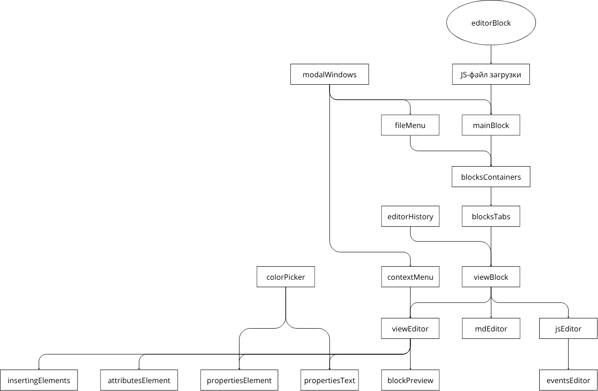

# Документация editorBlock

`editorBlock` - редактор HTML-блоков, предназначенный для создания и редактирования MD, CSS и JS-кода через веб-интерфейс.

## Структура внешнего вида

### Верхняя панель
- Меню действий с файлами - сохранение, открытие и создание блоков
- Вкладки блоков - переключение между открытыми блоками
- Кнопки назад / вперёд - навигация по истории изменений
- Кнопка предпросмотра - переключение в режим предпросмотра блока

### Левая панель
- Кнопки вставки элементов (разбитые по вкладкам) - добавление HTML-элементов в текущий блок

### Центральная панель
- Визуальный редактор с iframe-превью
- Редактор MD-кода
- Редактор JS-кода
- Кнопки переключения режимов (визуальный / MD / JS)

### Правая панель
- Вкладки переключения разделов свойств
- Свойства текста - параметры текста (цвет, размер, выравнивание и т. д.)
- Свойства элемента - стили и свойства выбранного элемента
- Атрибуты элемента - HTML-атрибуты элемента (id, class, data-*)
- Редактор событий - JS-события элемента и назначение обработчиков

## Модули

Модуль - отдельный компонент редактора, который отвечает за свою часть интерфейса или логики. В текущей реализации редактор загружает набор модулей последовательно и затем инициализирует их через общий event `editorBlock:loaded`.

### Основа редактора
- [mainBlock](./modules/mainBlock.md) - каркас редактора, управление блоками, вкладками, синхронизацией редакторов, выделением элементов и iframe

### Работа с файлами
- [fileMenu](./modules/modules/fileMenu.md) - меню действий с текущим блоком: сохранить, сохранить как, открыть файл и создать новый блок

### Управление модулями
- [blocksContainers](./modules/modules/blocksContainers.md) - контейнеры для хранения HTML/CSS/JS содержимого каждого блока
- [blocksTabs](./modules/modules/blocksTabs.md) - вкладки открытых блоков
- [rightPanelTabs](./modules/modules/rightPanelTabs.md) - переключение вкладок правой панели
- [viewBlock](./modules/modules/viewBlock.md) - переключение режимов редактора: визуальный, MD и JS
- [editorHistory](./modules/modules/editorHistory.md) - история изменений с поддержкой Undo/Redo по блокам и редакторам
- [blockPreview](./modules/modules/blockPreview.md) - режим предпросмотра блока

### Редакторы
- [viewEditor](./modules/modules/viewEditor.md) - визуальный редактор модуля
- [mdEditor](./modules/modules/mdEditor.md) - редактор MD-кода
- [cssEditor](./modules/modules/cssEditor.md) - редактор CSS-стилей
- [jsEditor](./modules/modules/jsEditor.md) - редактор JS-кода

### Редактирование
- [insertingElements](./modules/modules/insertingElements.md) - вставка HTML-элементов в модуль
- [propertiesText](./modules/modules/propertiesText.md) - свойства текста
- [propertiesElement](./modules/modules/propertiesElement.md) - свойства элемента (размеры, отступы и т. д.)
- [attributesElement](./modules/modules/attributesElement.md) - HTML-атрибуты элемента (id, class, data-*)
- [eventsEditor](./modules/modules/eventsEditor.md) - JS-события элемента (обработчики и назначение функций)

### Всплывающие окна
- [colorPicker](./modules/modules/colorPicker.md) - выбор цвета через окно
- [contextMenu](./modules/modules/contextMenu.md) - контекстное меню (по правому клику)
- [modalWindows](./modules/modules/modalWindows.md) - модальные окна

## Схема зависимостей и иерархии модулей

Нижние модули зависят от верхних, получая от верхних данные и функции.

