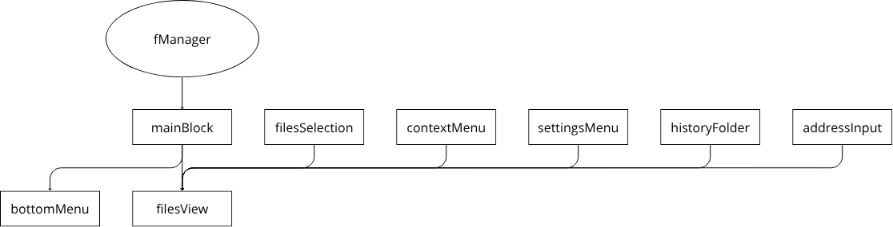

# Документация fManager

`fManager` - файловый менеджер, предназначенный для просмотра и управления файлами и папками через веб-интерфейс.

## Структура внешнего вида

### Шапка
- `Меню настройки` - параметры файл менеджера
    - `Сортировка` - параметры сортировки файлов
    - `Режим просмотра` - режим отображения файлов (таблица, столбцы, плитка)
- `Название` - название файл менеджера
- `Кнопка закрытия` - закрытие файл менеджера

### Верхняя панель
- `Кнопки навигации` - переходы по истории папок
    - `Вверх` - переход в родительскую папку
    - `Назад` - переход к предыдущей папке
    - `Вперёд` - переход к следующей папке
- `Поле пути / поиска` - отображение текущего пути или ввод имени файла для поиска
- `Кнопка поиска` - поиск файлов и папок по имени

### Центральная панель
- `Область файлов` - отображение файлов и папок текущего каталога с их данными

### Нижняя панель
- `Поле имени` - отображение выбра йствия с файлом (открыть, сохранить итд.)

## Блоки

Блок - папка, представляющая отдельный модуль файл менеджера, содержит файлы логики и интерфейса.

### Основа файл менеджера
- `mainBlock` - основной каркас файл менеджера и базовые стили/логика
    - общая структура интерфейса файл менеджера
    - базовые стили интерфейса и элементов
    - принятие настроек вызова (включить нижнее меню, сохранить итд.)
    - отправка ответа при закрытии или действиях (сохранить итд.)

### Верхняя панель
- `settingsMenu` - настройки файл менеджера
    - отображение меню `Сортировка` и `Режим просмотра`
    - изменение параметров сортировки файлов (по имени, размеру итд.)
    - настройка отображения папок и скрытых объектов
    - изменение режима отображения файлов (таблица, столбцы, плитка)
- `historyFolder` - история переходов по папкам
    - отображение кнопок перехода
    - переход и хранение истории путей и переходов
- `addressInput` - адресная строка
    - отображение пути и поиска файлов
    - изменение папки отображения файлов
    - поиск файлов по имени

### Основная область
- `filesView` - отображение файлов
    - рендер файлов и папок в центральной области
    - управление отображением элементов интерфейса
- `filesSelection` - выделение файлов
    - логика выделения файлов
    - хранение выбранных объектов

### Нижняя панель
- `bottomMenu` - нижнее меню действий
    - отображение поля имени и кнопки действия
    - выбор файла через поле
    - выполнение действия с выбранным файлом

### Меню
- `contextMenu` - контекстное меню действий с файлами
    - отображение меню при клике
    - `Создать папку` - создание новой папки
    - `Создать файл` - создание нового файла
    - `Вставить` - вставка файла или папки
    - `Копировать` - копирование файла или папки
    - `Вырезать` - перемещение файла или папки
    - `Переименовать` - открытие окна переименования
    - `Свойства` - открытие окна свойств объекта
    - `Удалить` - удаление файла или папки
    - `Загрузить файл` - загрузка файла
    - `Загрузить папку` - загрузка папки
    - `Поделиться` - открытие окна настройки доступа
    - `Скачать` - скачивание файла или папки
- `sharMenu` - окно настройки доступа к файлу или папке
    - добавление пользователей с доступом
    - удаление пользователей из списка доступа
    - выбор уровня доступа
    - сохранение изменений доступа
- `filePropertiesMenu` - окно свойств файла или папки
    - отображение информации об файле или папки
- `renameMenu` - окно переименования файла или папки
    - отображение текущего имени
    - ввод нового имени
    - подтверждение переименования
    
    

## Схема зависимостей и иерархии блоков

Нижние блоки зависят от верхних, получая от верхних данные и функции.

