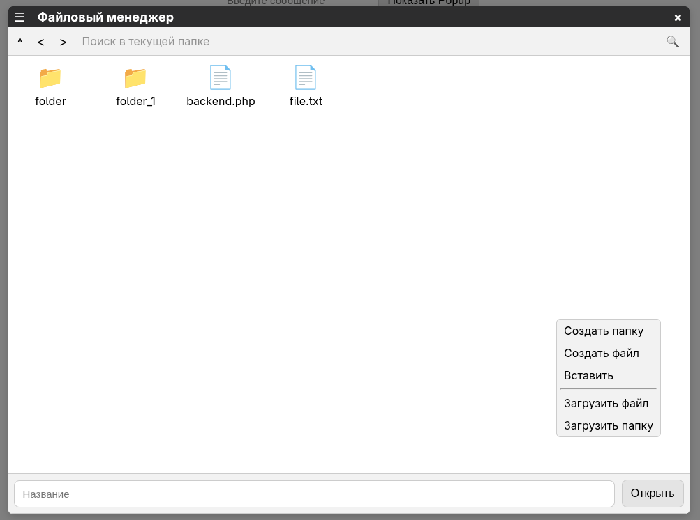

# Документация fManager

`fManager` - файловый менеджер, предназначенный для просмотра и управления файлами и папками через веб-интерфейс.

## Структура внешнего вида

### Шапка
- `Меню настройки` - параметры файл менеджера
    - `Сортировка` - параметры сортировки файлов
    - `Режим просмотра` - режим отображения файлов (таблица, столбцы, плитка)
- `Название` - название файл менеджера
- `Кнопка закрытия` - закрытие файл менеджера

### Верхняя панель
- `Кнопки навигации` - переходы по истории папок
    - `Вверх` - переход в родительскую папку
    - `Назад` - переход к предыдущей папке
    - `Вперёд` - переход к следующей папке
- `Поле пути / поиска` - отображение текущего пути или ввод имени файла для поиска
- `Кнопка поиска` - поиск файлов и папок по имени

### Центральная панель
- `Область файлов` - отображение файлов и папок текущего каталога с их данными

### Нижняя панель
- `Поле имени` - отображение выбра йствия с файлом (открыть, сохранить итд.)

## Модули

### Основа файл менеджера
- [mainBlock](./modules/mainBlock.md) - основной каркас файл менеджера и базовые стили/логика

### Верхняя панель
- [settingsMenu](./modules/modules/settingsMenu.md) - настройки файл менеджера
- [historyFolder](./modules/modules/historyFolder.md) - история переходов по папкам
- [addressInput](./modules/modules/addressInput.md) - адресная строка

### Основная область
- [filesView](./modules/modules/filesView.md) - отображение файлов
- [filesSelection](./modules/modules/filesSelection.md) - выделение файлов

### Нижняя панель
- [bottomMenu](./modules/modules/bottomMenu.md) - нижнее меню действий

### Меню
- [contextMenu](./modules/modules/contextMenu.md) - контекстное меню действий с файлами
- [sharMenu](./modules/modules/sharMenu.md) - окно настройки доступа к файлу или папке
- [filePropertiesMenu](./modules/modules/filePropertiesMenu.md) - окно свойств файла или папки
- [renameMenu](./modules/modules/renameMenu.md) - окно переименования файла или папки
    
    

## Схема зависимостей и иерархии блоков

Нижние блоки зависят от верхних, получая от верхних данные и функции.

